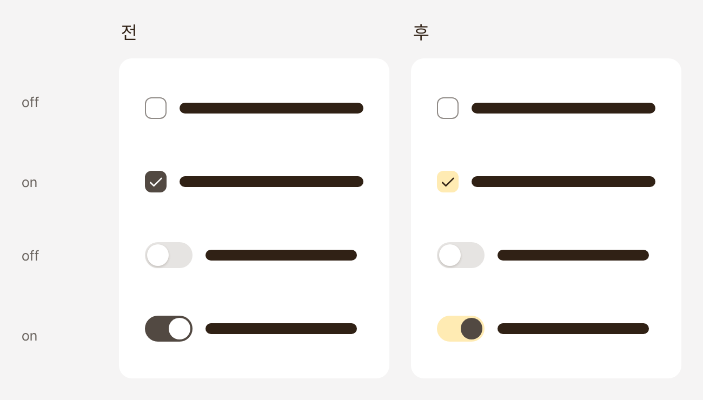
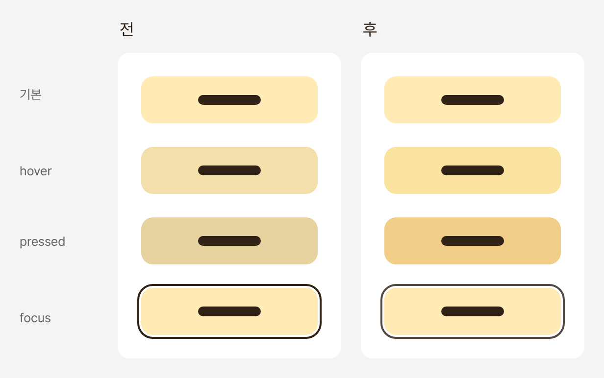
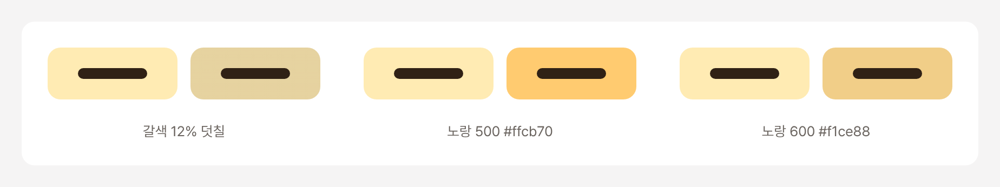
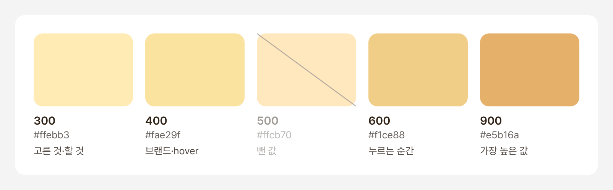
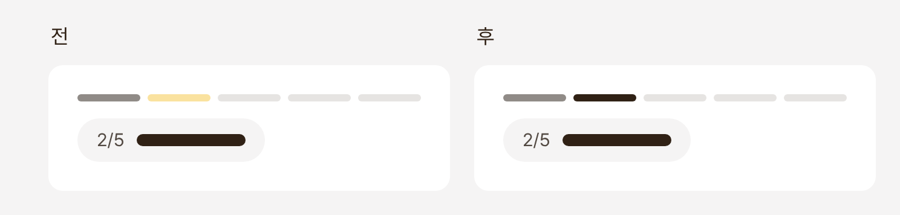
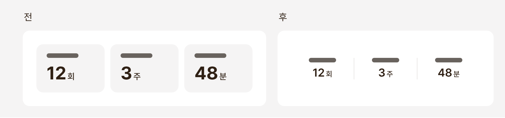
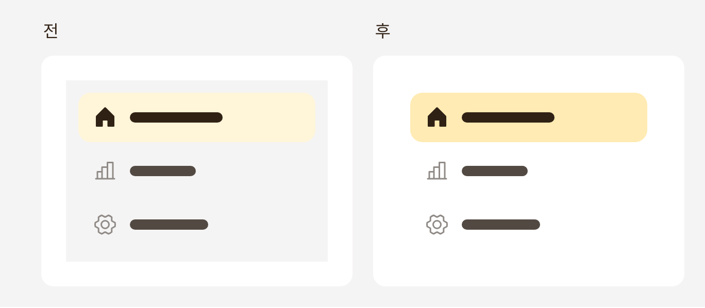

[1탄](/posts/2026-10-27-efg-design-system-1/)을 마치고 남은 불만은 이랬다.

- 버튼 상태에 따라서 너무 ㄸ색으로 보이는데...
- 사이드바의 회색 배경에 노랑 강조색은 너무 안 보이는데...
- 브랜드 색상이 너무 미미한데..

## 1. 갈색을 빼고 노랑으로

켜짐, 선택, 진행, 포커스를 전부 진한 갈색이 맡고 있었다. 구분은 체크와 아이콘에 맡기고, 면은 노랑으로 돌렸다. 포커스 선도 한 단계 연하게.

  <figure></figure>
  <figure></figure>

## 2. 답은 맨 처음 팔레트에

이번엔 버튼을 누르는 순간의 색이 문제였다. 1탄에서는 노랑 위에 갈색을 살짝 덮어 진하게 했는데, 그랬더니 노랑이 아니라 탁한 올리브색이 됐다. 그래서 더 진하고 쨍한 노랑(500)을 새로 만들었더니 혼자 튀었다.

  <figure></figure>

결국 맨 처음 팔레트로 돌아가서 역할이 있는 네 단계만 남겼다.

  <figure></figure>

## 3. 노랑을 쓰지 않는 자리

브랜드 색을 입힌다고 또 너무 노랑노랑하게 만들고 싶지는 않았다. 노랑은 내가 고른 것, 할 것에만. 단계 표시처럼 상태를 알리는 곳에서는 빼고, 글자와 같은 진한 색으로 바꿨다.

  <figure></figure>

## 4. 앱은 앱대로, 대시보드는 대시보드대로

앱에 들어간 대시보드 스타일의 숫자 타일은 성적표같이 느껴졌다. 시스템은 하나로 두되, 특정 제품에서만 사용할 것들을 분류했다.

  <figure></figure>

사이드바도 회색 바탕을 없앴다. 회색 위에서는 노랑이 보이지 않았다.

  <figure></figure>

회색 바탕을 유지하면서 노랑을 진하게 만드는 대신에 노랑은 쓸 자리에서만 쓰자 싶었다.

이러는 와중에 새로운 화면이 생겼다. 새 화면에 대한 디자인 시스템 적용은 3탄에서...
