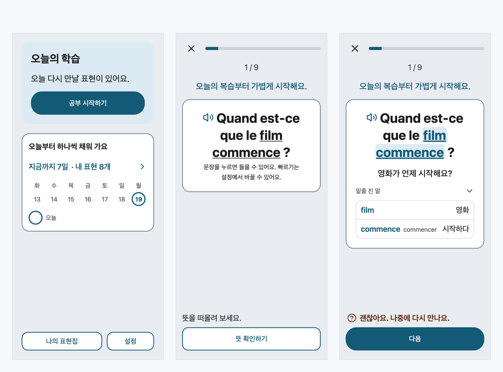
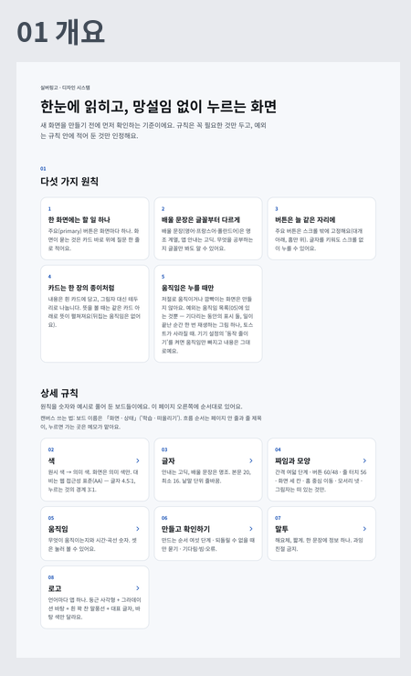
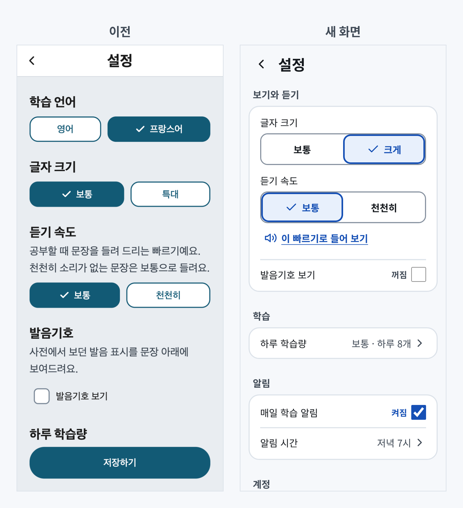
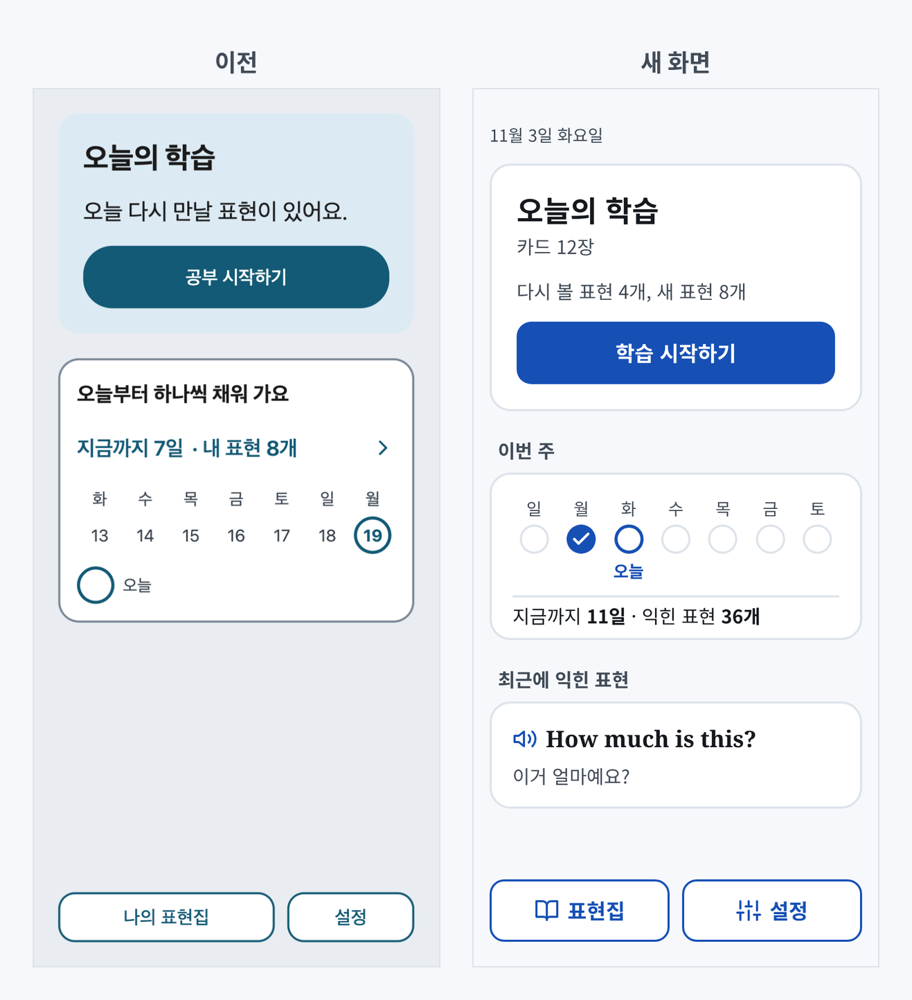
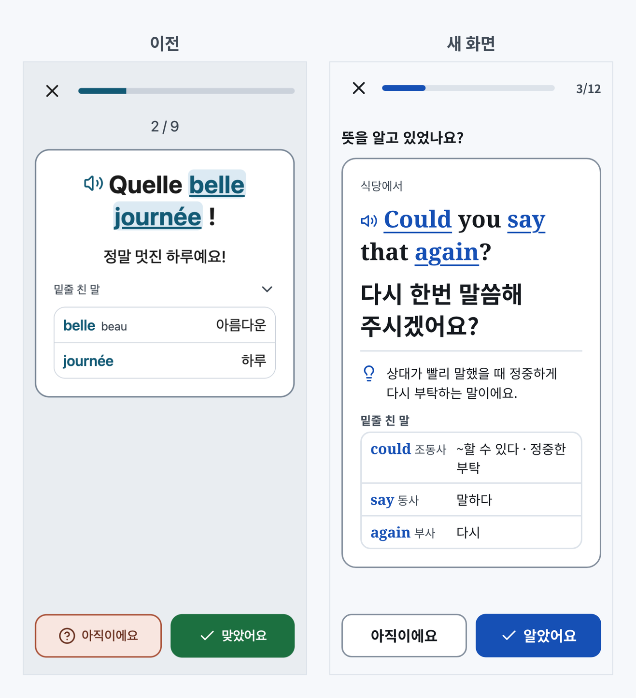
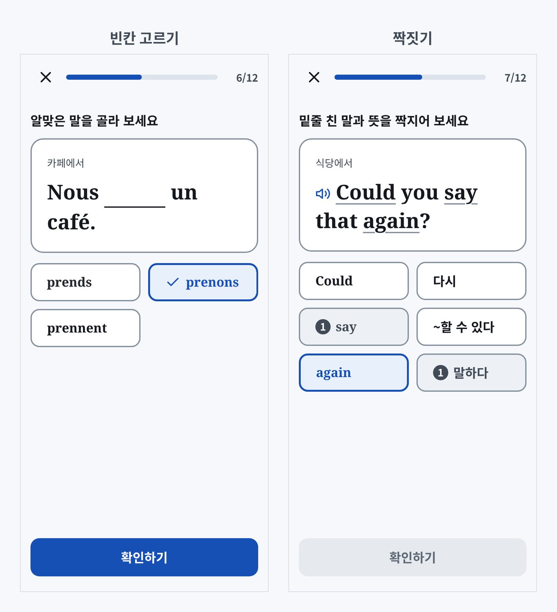
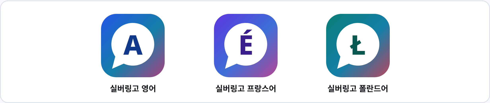
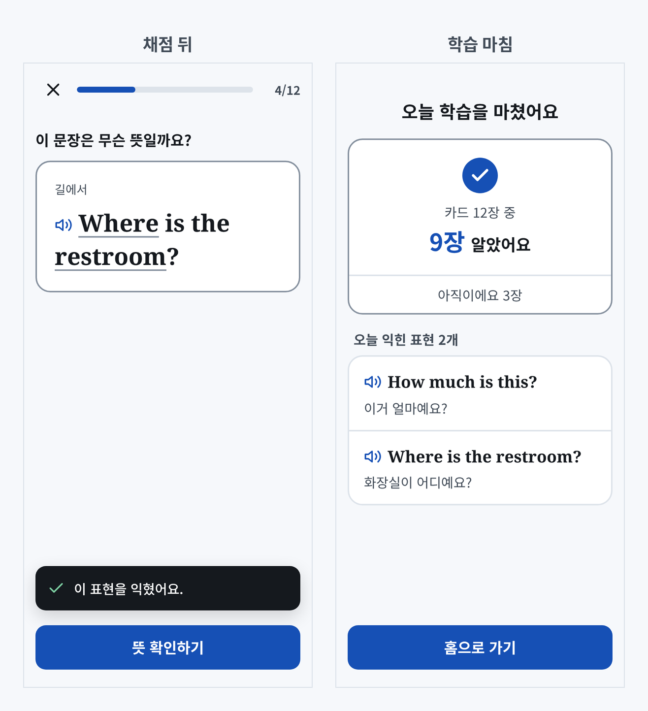

[1편](/posts/2026-10-19-silver-lingo/)을 쓰면서 화면을 이래저래 정리하긴 했는데, 다시 보니 여전히 어수선했다. 과잉 친절처럼 느껴지는 곳도 있었다. 특히 듣기 안내.

- 학습 카드마다 "문장을 누르면 들을 수 있어요. 빠르기는 설정에서 바꿀 수 있어요."가 붙어 있었다.
- 문장 앞에 스피커 아이콘이 있으니 한 번 눌러 보면 아는 내용인데...

  <figure></figure>

이런 문구를 화면마다 하나씩 지워도, 새 화면을 만들면 또 생길 것 같았다. 그래서 화면 몇 개를 고치는 대신 원칙부터 바꾸기로 했다. 목표는 더 간결하고, 깔끔하고, 산뜻한 화면.

## 화면

작업은 Claude의 디자인 아티팩트에서 했다. 화면을 그리기 전에 규칙부터 정했다. 한 화면에는 할 일 하나, 자동 저장처럼 당연한 동작은 설명하지 않기 같은 것들이다.

시안 화면도 원본 부품(컴포넌트)을 가져다 쓰도록 만들었다. 원본 부품 하나를 고치면 그 부품을 쓰는 화면이 한꺼번에 바뀐다. 부품 이름과 구성은 앱 코드의 컴포넌트와 똑같이 맞춰 두었고, 현재 이 구조 그대로 코드로 옮기고 있다.

  <figure></figure>

색은 더 산뜻하게 바꾸고, 화면의 안내와 설명은 많이 덜어냈다.

  <figure></figure>
  <figure></figure>
  <figure></figure>

대신 학습 방식은 오히려 늘렸다. 뜻을 떠올리고 스스로 채점하는 카드, 빈칸 문제에 더해 밑줄 친 말과 뜻을 짝짓는 카드를 새로운 문제 유형으로 추가했다.

  <figure></figure>

아이콘도 새 색에 맞춰 다시 만들었다. 언어마다 앱이 따로 나가니까 흰 말풍선 모양은 그대로 두고, 바탕 그라데이션 색과 그 언어를 대표하는 글자만 바꿨다. 프랑스어 앱은 É.

  <figure></figure>

## 말

처음 기획에서는 앱이 정답과 오답을 가려 보여 주는 대신, 사용자가 "맞았어요"와 "아직이에요" 중에 스스로 고르게 했다. 새 화면에서는 이 버튼을 "아직이에요"와 "알았어요"로 바꿨다. 그런데 채점 버튼이 아닌 곳에서 "알았어요" 같은 말이 나오니, "그래서 무엇을 알았다는 거지?" 싶었다.

결국 앱에서 쓰는 표현을 대부분 다시 정했다.

- "익힌 표현"은 서로 다른 두 번의 학습에서 "알았어요"를 고른 표현에만 쓴다. 한 번 알았다고 익혔다고 하기는 이르니까.
- "편하게", "함께"처럼 듣기 좋게 덧붙인 말, 자동 저장처럼 당연한 동작에 대한 설명은 뺐다.

  <figure></figure>

화면을 고친 것보다 규칙을 먼저 정한 것이 더 큰 변화였다. 앞으로 화면을 더할 때도 이 규칙에서 시작할 생각이다.

새 화면은 아직 코드로 옮기는 중이라, 지금 [silver-lingo.vercel.app](https://silver-lingo.vercel.app)에서는 이전 화면이 보인다.
