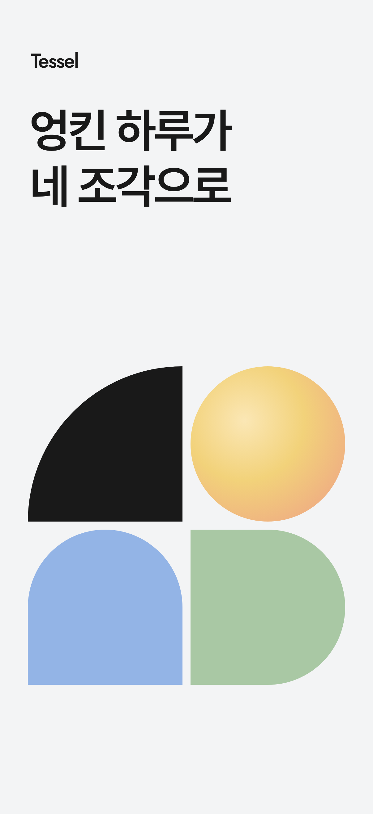
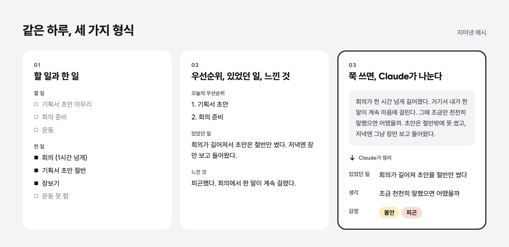
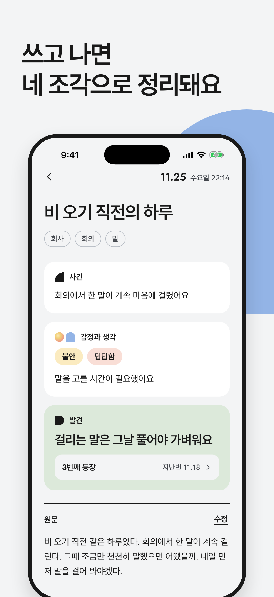
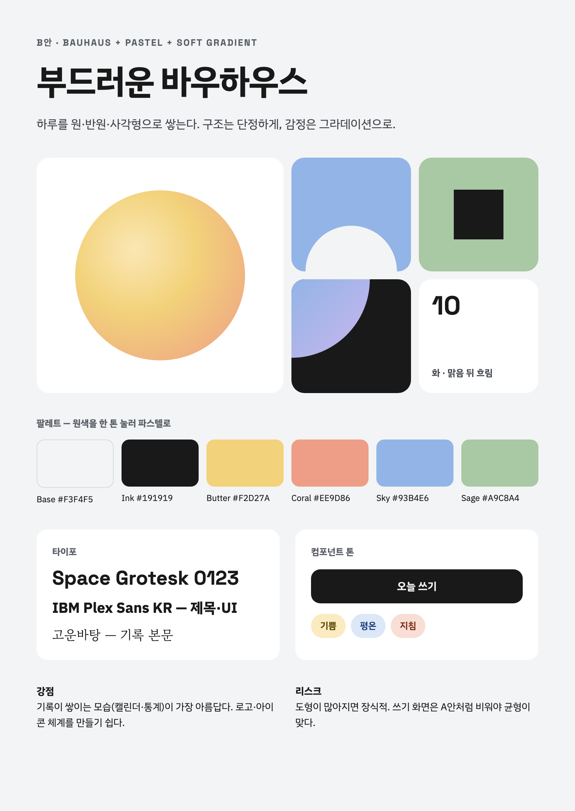
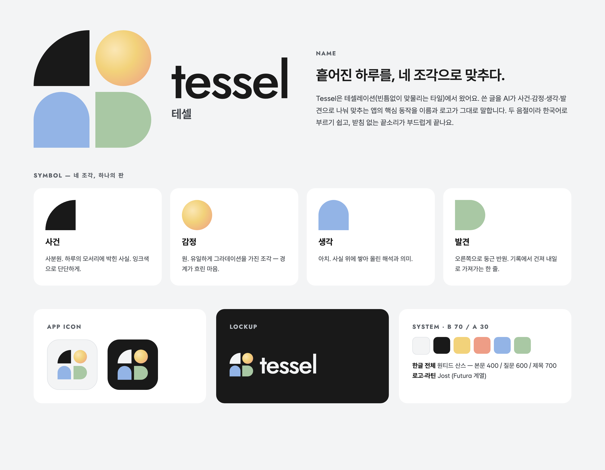
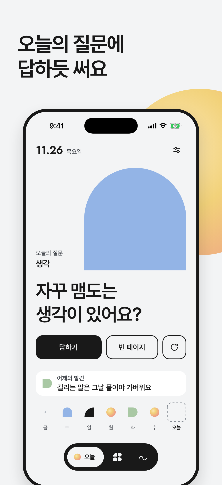
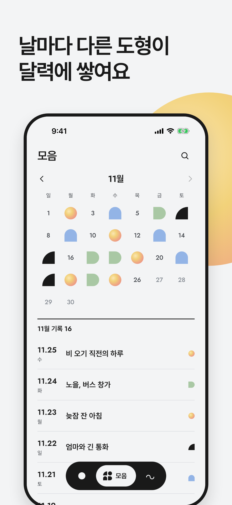
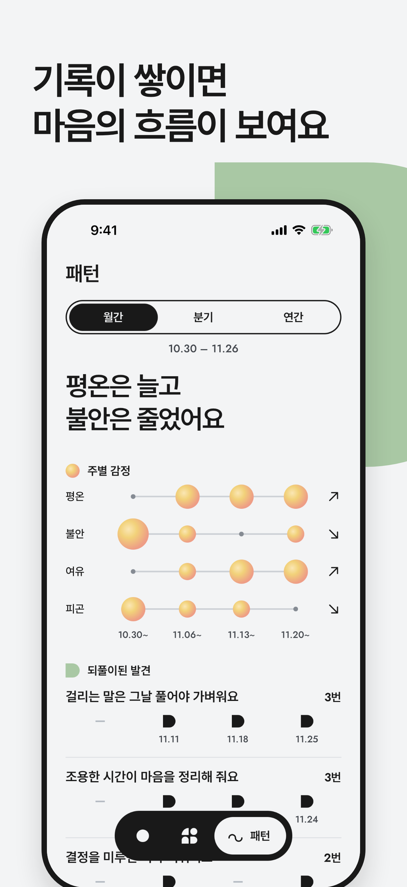

작년부터 거의 1년 동안 Claude에게 일기를 쓰고 정리하게 했다. 그 경험을 그대로 앱으로 옮긴 게 Tessel이다. 지금 App Store 심사 중이다.

  <figure></figure>

## 1년 동안 바뀐 일기 형식

형식은 그동안 몇 번 바뀌었다.

1. 투두리스트와 실제로 한 일을 기록했다.
2. 오늘 우선 처리할 일, 있었던 일, 내가 느낀 것을 기록했다.
3. 내가 쭉 일기를 쓰면, Claude가 실제 있었던 일과 내 생각·감정을 나눠 준다.

마지막 방식에 정착했다. 쓰는 동안은 형식을 신경 쓰지 않고, 정리는 맡긴다.

  <figure><figcaption>같은 하루, 세 가지 형식 (지어낸 예시)</figcaption></figure>

그러다 주절주절 쓰는 일기가 아니라 구조화된 일기, 기록을 남기는 일기를 다른 누군가도 원하지 않을까 하는 생각이 들었다. 그래서 앱을 만들기 시작했다.

## 감정은 Claude가 포착한다

1년 동안 가장 쓸모 있었던 건 감정을 따로 적지 않아도 된다는 점이었다. 글의 내용과 어조를 보고 어떤 감정이 담겨 있는지 Claude가 알아서 포착하게 했고, 이걸 앱에 그대로 넣었다.

쓰고 나면 글이 네 조각으로 정리된다.

- 사건: 무슨 일이 있었는지
- 감정: 그때 마음이 어땠는지
- 생각: 무엇이 떠올랐는지
- 발견: 오늘 건진 한 문장

  <figure><figcaption>정리된 결과</figcaption></figure>

감정은 정해 둔 12개 안에서만 고른다. 목록이 고정되어 있어야 몇 주 뒤에 "평온은 늘고 불안은 줄었어요" 같은 비교를 할 수 있다.

| | 기운 높음 | 기운 낮음 |
| --- | --- | --- |
| 기분 좋음 | 기쁨, 설렘, 뿌듯함 | 평온, 여유, 고마움 |
| 기분 나쁨 | 불안, 화, 답답함 | 슬픔, 피곤, 외로움 |

그렇다! 포착된 감정은 사용자가 고칠 수 없다. 원문을 고쳐 다시 정리할 수는 있지만, 감정을 직접 바꾸는 기능은 없다.

일기를 쓸 때마다 느꼈다. 내가 느낀 감정을 구체적인 단어로 말하는 게 생각보다 어렵다. 어휘력이 부족한 걸까, 솔직함이 부족한 걸까. 어느 쪽이든 내가 고르면 머뭇거리게 된다. 그래서 고르는 일은 글을 읽은 Claude에게 맡기고, 나는 쓰는 데만 집중하기로 했다.

## 모던, 그리고 바우하우스

컨셉은 모던으로 잡았다. 정리를 해 주는 앱인 만큼 깔끔한 인상을 주고 싶었다. 바우하우스를 주요 키워드로 이미지를 찾아 무드보드를 만들었다.

예시로 이런 이미지들:

- 요스트 슈미트, [바우하우스 전시 포스터](https://commons.wikimedia.org/wiki/File:Joost_Schmidt_Bauhausausstellung_1923.jpg) (1923)
- 오스카 슐레머, [트리아딕 발레 프로그램](https://commons.wikimedia.org/wiki/File:Das_Triadische_Ballett,_Programmzettel_1922.jpg) (1922)
- 라슬로 모호이너지, [바우하우스 전시 엽서](https://commons.wikimedia.org/wiki/File:L%C3%A1szl%C3%B3_Moholy-Nagy_Bauhausausstellung_1923.jpg) (1923)
- 피트 몬드리안, [Composition II in Red, Blue, and Yellow](https://commons.wikimedia.org/wiki/File:Piet_Mondriaan,_1930_-_Mondrian_Composition_II_in_Red,_Blue,_and_Yellow.jpg) (1930)
- [바우하우스 100주년 기하 포스터](https://commons.wikimedia.org/wiki/File:Bauhaus_100th_anniversary_geometric_poster_1919-2019.svg) (2019)

화면을 그리기 전에 방향 시안을 셋 만들었고, 바우하우스의 도형에 파스텔과 그라데이션을 섞은 안을 골랐다. 서체는 나중에 원티드 산스와 Jost로 바꿨다.

  <figure><figcaption>초기 방향 시안. 부드러운 바우하우스</figcaption></figure>

원색을 한 톤 눌러 파스텔로 쓰고, 네 조각을 도형 하나씩으로 정했다. 이름은 테셀레이션(빈틈없이 맞물리는 타일)에서 왔다.

| 조각 | 도형 | 이유 |
| --- | --- | --- |
| 사건 | 사분원 | 사실이라 잉크색으로 단단하게 |
| 감정 | 원 | 경계가 흐린 마음이라 유일하게 그라데이션을 넣었다 |
| 생각 | 아치 | 사실 위에 쌓아 올린 해석 |
| 발견 | 반원 | 기록에서 건져 내일로 가져가는 한 줄 |

  <figure><figcaption>이름과 로고</figcaption></figure>

이 도형이 앱 곳곳에 그대로 쓰인다. 홈의 큰 도형은 오늘의 질문이 어느 조각을 묻는지에 따라 바뀌고, 달력에는 날마다 그날 기록의 도형이 쌓인다.

  <figure><figcaption>홈</figcaption></figure>
  <figure><figcaption>모음</figcaption></figure>

기록이 쌓이면 패턴 화면에서 최근 4주·3개월·1년 동안 어떤 감정이 늘고 줄었는지, 어떤 발견이 되풀이됐는지 볼 수 있다.

  <figure><figcaption>패턴</figcaption></figure>

## 저장은 내 기기에

서버 비용이나 개인정보 관리는 생각만 해도 골치가 아팠다. 그래서 일기는 기기에만 저장한다. 회원 가입도 없다.

서버를 거치는 건 정리할 때뿐이다. 글을 Claude에 보내 네 조각으로 나눠 받고, 중간 서버는 글을 저장하지 않는다. 기록 하나를 정리할 때마다 API 비용이 아주 조금 든다. 내가 쓰려고 만든 앱이니까 그 정도는 일단 감안해 보려 한다.

Tessel은 지금 App Store 심사 중이다. 통과하면 여기에 링크를 붙일 생각이다.

이름을 테셀레이션에서 따온 만큼, 내가 좋아하는 노래 Tesselation(Mild High Club)을 듣고 가시길.

<iframe src="https://www.youtube-nocookie.com/embed/OeNID491JiQ" title="Mild High Club - Tesselation" style="width: 100%; aspect-ratio: 16 / 9; border: 1px solid var(--ink); margin: 16px 0" allow="encrypted-media; picture-in-picture" allowfullscreen loading="lazy"></iframe>
